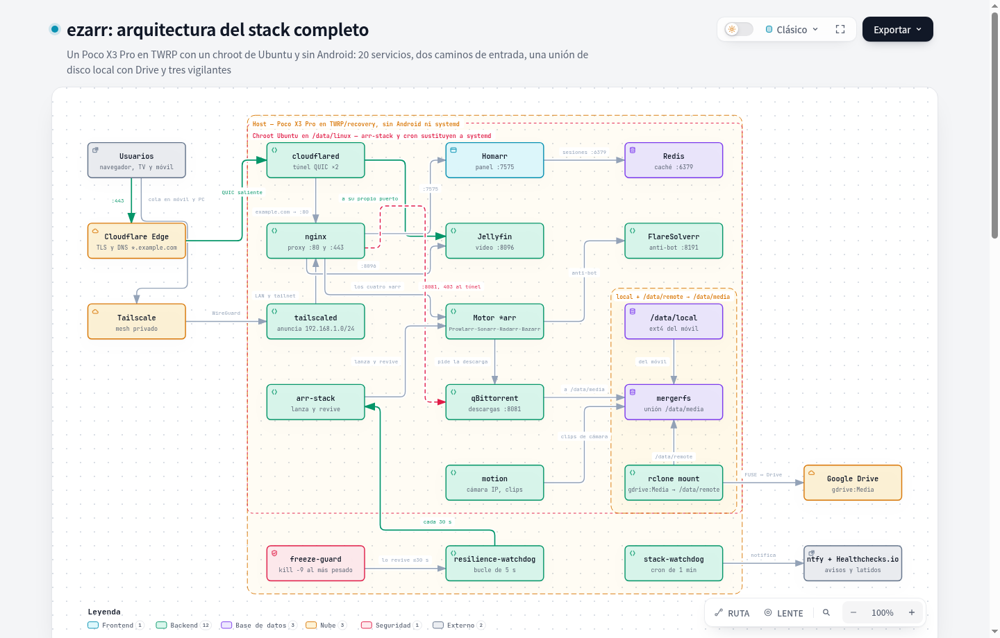
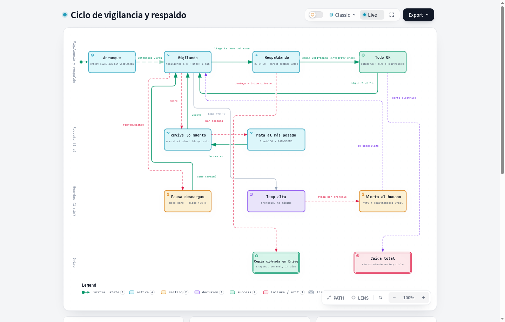
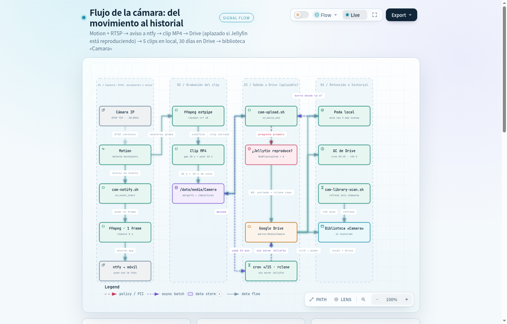

# ezarr-stack ⚡

[](https://madmanjohnsmith.github.io/ezarr-stack/)
[](tests/smoke.sh)
[](LICENSE)
[](https://trash-guides.info/)

> **Servidor multimedia con stack \*arr y Jellyfin blindado para producción, optimizado para equipos ARM64 de bajo consumo y teléfonos Android reciclados mediante un chroot Ubuntu bajo TWRP.**
>
> 🌐 [**English**](README.md) | 🇪🇸 [**Español**](README.es.md) | 📊 [**Explorador Interactivo de Arquitectura**](https://madmanjohnsmith.github.io/ezarr-stack/)

---

## 🏛️ Arquitectura y Topología Interactiva

Explora los diagramas del sistema, capas de red de servicios y almacenamiento híbrido directamente desde tu navegador:

👉 **[Abrir Explorador Interactivo de Arquitectura](https://madmanjohnsmith.github.io/ezarr-stack/)** *(Alojado en GitHub Pages)*

### 1. Arquitectura Completa del Stack
Chroot de Ubuntu sobre TWRP (*vayu* / ARM64), almacenamiento híbrido por niveles (F2FS local + Google Drive VFS mediante Mergerfs), túnel Cloudflare Zero Trust, red VPN Tailscale y binarios nativos del stack \*arr:

[](https://madmanjohnsmith.github.io/ezarr-stack/stack-architecture.html)

### 2. Resiliencia, Vigilantes y Auto-Curación
Bucle continuo de auto-curación cada 5 segundos (`resilience-watchdog`), sondeo de salud del stack con Healthchecks.io, control térmico, detección proactiva de malware y respaldos cifrados semanales:

[](https://madmanjohnsmith.github.io/ezarr-stack/ciclo-vigilancia-respaldo.html)

### 3. Canal de Cámara y Detección de Movimiento
Captura RTSP de cámara IP, motor de detección de movimiento con `motion`, subida automática a la nube y alertas push inmediatas mediante `ntfy`:

[](https://madmanjohnsmith.github.io/ezarr-stack/flujo-camara.html)

---

## 💡 ¿Por qué ezarr-stack?

La mayoría de tutoriales de servidores multimedia asumen un servidor x86 con Docker, alto consumo eléctrico y discos mecánicos directos. **ezarr-stack** resuelve un reto de ingeniería muy distinto: **reutilizar hardware silencioso ARM64 de bajo consumo (< 5W) para convertirlo en un servidor 24/7 sin mantenimiento.**

1. **Gestor de Procesos Nativo Sin Systemd**:
   Los kernels de recuperación y chroot en Android no soportan systemd ni Docker. `arr-stack` proporciona supervisión de procesos ligera, orden determinista de arranque y parada, y ajuste de `oom_score_adj` (blindando a Jellyfin y despriorizando crawlers).
2. **Almacenamiento Híbrido por Niveles (Mergerfs + Rclone VFS Crypt)**:
   Supera el espacio limitado de la memoria flash integrando almacenamiento local rápido con Google Drive cifrado en un montaje unificado `/data/media` con descarga automática de espacio local.
3. **Estándares TRaSH Guides y POSIX UMASK=002**:
   Todos los servicios heredan `UMASK=002`, garantizando que archivos descargados (`0664`) y directorios (`0775`) sean accesibles atómicamente por Sonarr, Radarr y Jellyfin sin requerir bucles inseguros de `chmod -R 777`.
4. **Optimización BitTorrent Dual TCP + UDP (Puerto 6881)**:
   qBittorrent está configurado para trackers DHT modernos utilizando protocolo híbrido TCP y uTP, eliminando bloqueos de cola y maximizando conexiones con peers.
5. **Cero Puertos Abiertos a Internet (Túnel Cloudflare + Malla Tailscale)**:
   El tráfico exterior se enruta mediante túneles seguros cifrados de Cloudflare Zero Trust y la malla WireGuard de Tailscale, sin necesidad de abrir puertos en el router.
6. **Autodefensa Contra Torrents Falsos y Ejecutables Maliciosos**:
   Heurística automatizada en el watchdog que detecta y purga inmediatamente releases falsas con `.exe` o scripts antes de desperdiciar ancho de banda o almacenamiento.
7. **Arranque Desatendido en TWRP**:
   Encendido autónomo tras corte de energía: el init stage 2 de TWRP ejecuta `overrideprops.sh`, monta `/data/linux`, enlaza los pseudofs del kernel y arranca todo el stack en ~15 segundos.

---

## 📦 Catálogo de Servicios y Puertos

| Servicio | Puerto | Descripción | Administrado Por |
|---|---|---|---|
| **Jellyfin** | `8096` | Servidor de streaming multimedia | `arr-stack` |
| **Sonarr** | `8989` | Gestión y seguimiento de series de TV | `arr-stack` |
| **Radarr** | `7878` | Gestión y seguimiento de películas | `arr-stack` |
| **Prowlarr** | `9696` | Gestor y proxy de indexadores torrent | `arr-stack` |
| **Bazarr** | `6767` | Descargador automatizado de subtítulos | `arr-stack` |
| **qBittorrent-nox** | `8080` (Web) / `6881` (TCP/UDP) | Cliente BitTorrent con DHT y uTP activo | `arr-stack` |
| **Homarr** | `7575` | Panel de control y dashboard ligero | `arr-stack` |
| **Nginx** | `80` / `8000` / `443` | Proxy inverso y control de acceso LAN | `arr-stack` |
| **FlareSolverr** | `8191` | Resolución de retos Cloudflare para indexadores | `arr-stack` |
| **Motion** | `8082` / RTSP | Detección de movimiento y videovigilancia | `arr-stack` |
| **Cloudflared** | Túnel | Acceso remoto Zero Trust con doble réplica | `arr-stack` |
| **Tailscale** | Tailnet | Malla segura WireGuard para administración | `arr-stack` |
| **Redis** | `6379` | Caché en memoria para aplicaciones | `arr-stack` |

---

## 🚀 Inicio Rápido

### 1. Requisitos Previos
- Un dispositivo ARM64 (ej. Poco X3 Pro, Raspberry Pi 4/5, o placa Linux SBC) con Ubuntu/Debian o chroot.
- Si usas un teléfono Android: sigue la [Guía de Recuperación TWRP](docs/recovery.md).

### 2. Comprobación Previa (Dry-Run)
Verifica siempre las operaciones antes de mutar el sistema:

```bash
# Previsualizar el plan sin realizar cambios
./ezarr.sh --dry-run --profile minimal
```

### 3. Instalación
```bash
# Ejecutar instalación
sudo ./ezarr.sh --yes --profile minimal
```

---

## 🔒 Gestión Segura de Secretos (`ezarrctl secrets`)

`ezarr-stack` incluye una interfaz CLI para configurar claves sensibles sin riesgo de subirlas a git:

```bash
# Inicializar archivo de secretos
ezarrctl secrets init

# Configurar claves o contraseñas
ezarrctl secrets set EZARR_CAMERA_RTSP_PASS "mi-clave-segura"
ezarrctl secrets set EZARR_NTFY_TOPIC "mi-topic-privado"
ezarrctl secrets set EZARR_SUBS_API_KEY "mi-clave-opensubtitles"

# Verificar permisos y presencia
ezarrctl secrets list
ezarrctl secrets doctor
```

Todas las credenciales quedan aisladas con permisos `0600` en `/etc/ezarr/secrets.conf`.

---

## 🛠️ Operación Diaria (`ezarrctl`)

El stack se controla de forma unificada mediante `ezarrctl`:

```bash
ezarrctl status           # Muestra el estado activo/parado de los servicios
ezarrctl start [servicio] # Arranca uno, varios o todos los servicios
ezarrctl stop [servicio]  # Detiene los servicios de forma ordenada
ezarrctl restart          # Reinicia respetando el árbol de dependencias
ezarrctl logs -f [servicio]# Visualiza registros en tiempo real
ezarrctl backup           # Crea un respaldo verificado de BBDD y configs
ezarrctl doctor           # Ejecuta diagnóstico completo de salud
```

---

## 📖 Documentación

- [Guía de Recuperación TWRP y Hardware](docs/recovery.md)
- [Instalación Completa Paso a Paso](docs/instalacion.md)
- [Operación Diaria y Mantenimiento](docs/operacion.md)
- [Arquitectura y Almacenamiento en Profundidad](docs/diagrams/stack-architecture.html)
- [Créditos y Reconocimientos](docs/creditos.md)

---

## 🤝 Reconocimientos y Créditos

`ezarr-stack` fue inspirado por y desarrollado con agradecimiento a [Luctia/ezarr](https://github.com/Luctia/ezarr) (Licencia MIT) y las recomendaciones comunitarias de [TRaSH Guides](https://trash-guides.info/).

---

## 📄 Licencia

Distribuido bajo la Licencia MIT. Consulta [LICENSE](LICENSE) para más detalles.
